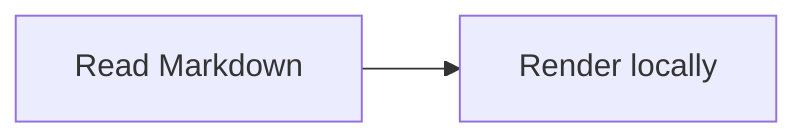
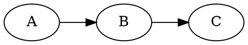
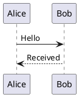
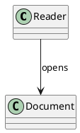

# Markdown rendering demo

Inline math: $a_b^2 + \frac{1}{2}$ and \(x_1 < x_2\).

$$
\int_0^1 x^2\,dx = \frac{1}{3}
$$

Reference with a footnote[^note].

[^note]: Footnotes remain ordinary selectable text.

> [!NOTE]
> This is a GitHub-style note.

!!! tip
    This is an indented admonition with **bold text**.

```python
def square(x):
    return x * x
```









```vega-lite
{"$schema":"https://vega.github.io/schema/vega-lite/v6.json","data":{"values":[{"label":"A","value":2},{"label":"B","value":5}]},"mark":"bar","encoding":{"x":{"field":"label","type":"nominal"},"y":{"field":"value","type":"quantitative"}}}
```

```vega
{"$schema":"https://vega.github.io/schema/vega/v6.json","width":240,"height":120,"data":[{"name":"table","values":[{"x":20,"y":30},{"x":100,"y":80}]}],"marks":[{"type":"symbol","from":{"data":"table"},"encode":{"enter":{"x":{"field":"x"},"y":{"field":"y"},"size":{"value":100},"fill":{"value":"steelblue"}}}}]}
```

```plotly
{"data":[{"x":[1,2,3],"y":[1,4,9],"type":"scatter","mode":"lines+markers"}],"layout":{"height":260,"title":{"text":"Squares"}}}
```
